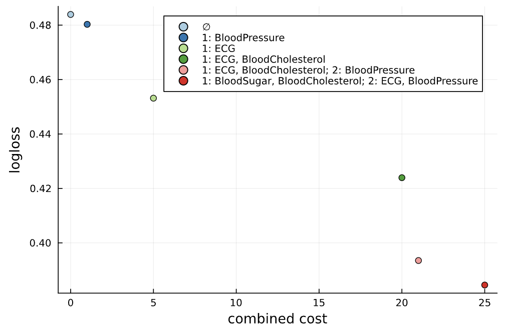
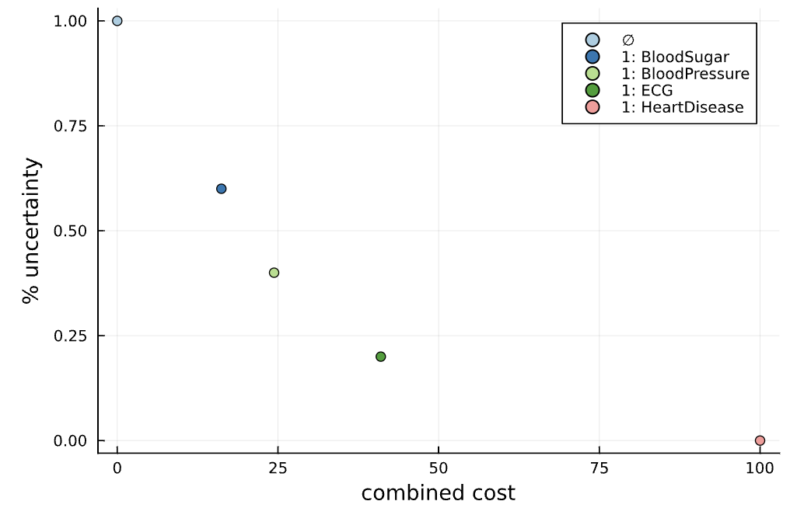
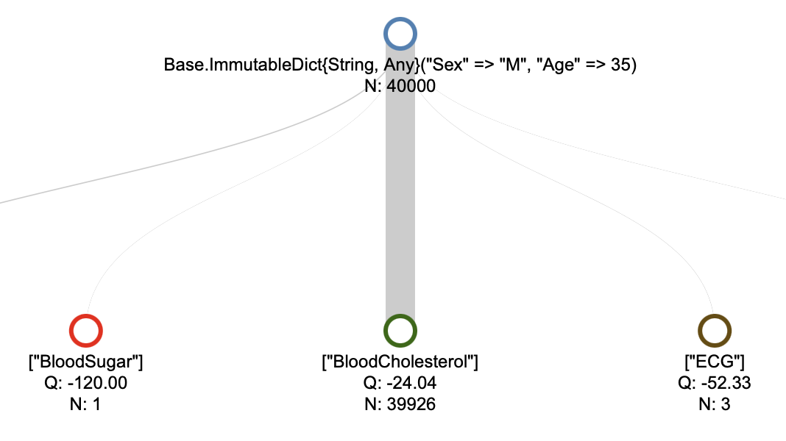

# CEEDesigns.jl: Overview

A decision-making framework for the cost-efficient design of experiments, balancing the value of acquired experimental evidence and incurred costs. We have considered two different experimental setups, which are outlined below.

```@raw html
<figure style="float: right; width: 400px;">
  
  <figcaption>Pareto front of experimental designs: each point is a set of experiments lying on the optimal tradeoff between information gain and incurred costs.</figcaption>
</figure>
```
## Motivating example: Cost-efficient glioma grading

Consider the task of distinguishing lower-grade glioma (LGG) from glioblastoma (GBM) using clinical information and molecular tests. Testing more genes may improve prediction, but each additional test incurs a cost. CEEDesigns.jl helps researchers compare combinations of tests without assuming that the most extensive panel is necessarily the best use of resources.

In the [glioma grading tutorial](tutorials/GliomaGrading.md), the costs of seven illustrative gene-mutation tests are stored in `experiments`, and the cross-validated predictive log loss for each test combination is stored in `perf_eval`. Once these inputs have been prepared, the decision and visualization require only a few lines:

```julia
using CEEDesigns, CEEDesigns.StaticDesigns

designs = efficient_designs(experiments, perf_eval)
plot_front(designs; labels = make_labels(designs), ylabel = "logloss")
```

**Reading the output:** The resulting [glioma grading Pareto-frontier plot](tutorials/GliomaGrading.md#cost-efficient-feature-selection) shows one cost-efficient test combination per point. The horizontal axis is the sum of the illustrative testing costs; the vertical axis is predictive log loss (**lower is better**). A design is Pareto-efficient if no other evaluated design has both an equal or lower cost and an equal or lower loss, with at least one strict improvement. The figure allows readers to judge how much additional predictive performance is associated with spending more on molecular testing, rather than prescribing one universal choice. These results illustrate a computational workflow, not a clinically validated diagnostic recommendation.

```@raw html
<figure style="float: right; width: 400px;">
  
  <figcaption>Pareto front of experimental designs: each point is a set of experiments lying on the optimal tradeoff between information gain and incurred costs.</figcaption>
</figure>
```


## Static experimental designs
Here we assume that the same experimental design will be used for a population of examined entities, hence the word "static".

For each subset of experiments, we consider an estimate of the value of acquired information. To give an example, if a set of experiments is used to predict the value of a specific target variable, our framework can leverage a built-in integration with [MLJ.jl](https://github.com/alan-turing-institute/MLJ.jl) to estimate predictive accuracies of machine learning models fitted over subset of experimental features.

In the cost-sensitive setting of CEEDesigns.jl, a user provides the monetary cost and execution time of each experiment. Given the constraint on the maximum number of parallel experiments along with a fixed tradeoff between monetary cost and execution time, we devise an arrangement of each subset of experiments such that the expected combined cost is minimized.

Assuming the information values and optimized experimental costs for each subset of experiments, we then generate a set of cost-efficient experimental designs.

```@raw html
<figure style="float: right; width: 400px;">
  
  <figcaption>Pareto front for generative designs: a personalized front is generated for each experimental entity. Each point is an adaptive policy for one uncertainty threshold, labelled by its first experiment; the follow-up experiments depend on the readouts.</figcaption>
</figure>
```

## Generative experimental designs

We consider 'personalized' experimental designs that dynamically adjust based on the evidence gathered from the experiments. This approach is motivated by the fact that the value of information collected from an experiment generally differs across subpopulations of the entities involved in the triage process.

At the beginning of the triage process, an entity's prior data is used to project a range of cost-efficient experimental designs. Internally, while constructing these designs, we incorporate multiple-step-ahead lookups to model likely experimental outcomes and consider the subsequent decisions for each outcome. Then after choosing a specific decision policy from this set and acquiring additional experimental readouts (sampled from a generative model, hence the word "generative"), we adjust the continuation based on this evidence.

```@raw html
<figure style="float: left; width: 400px;">
  
  <figcaption>Explainability: a search tree produced by solving the Markov decision process, showing the information gain and accumulated cost of each path through the space of possible designs.</figcaption>
</figure>
```

We conceptualized the triage as a Markov decision process, in which we iteratively choose to conduct a subset of experiments and then, based on the experimental evidence, update our belief about the distribution of outcomes for the experiments that have not yet been conducted. The information value associated with the state, derived from experimental evidence, can be modeled through any statistical or information-theoretic measure such as the variance or uncertainty associated with the target variable posterior.

We implemented the following two variants of the decision-making process: Firstly, assuming that the decision-making process only terminates when the uncertainty drops below a given threshold, we minimize the expected resource spend. Secondly, we can optimize the value of experimental evidence, adjusted for the incurred experimental costs.

```@raw html
<div style="clear: both;"></div>
```